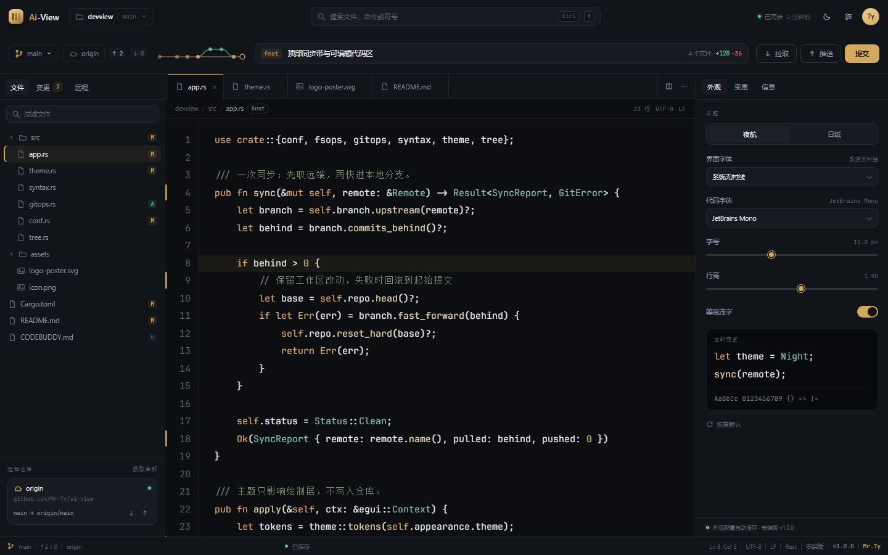
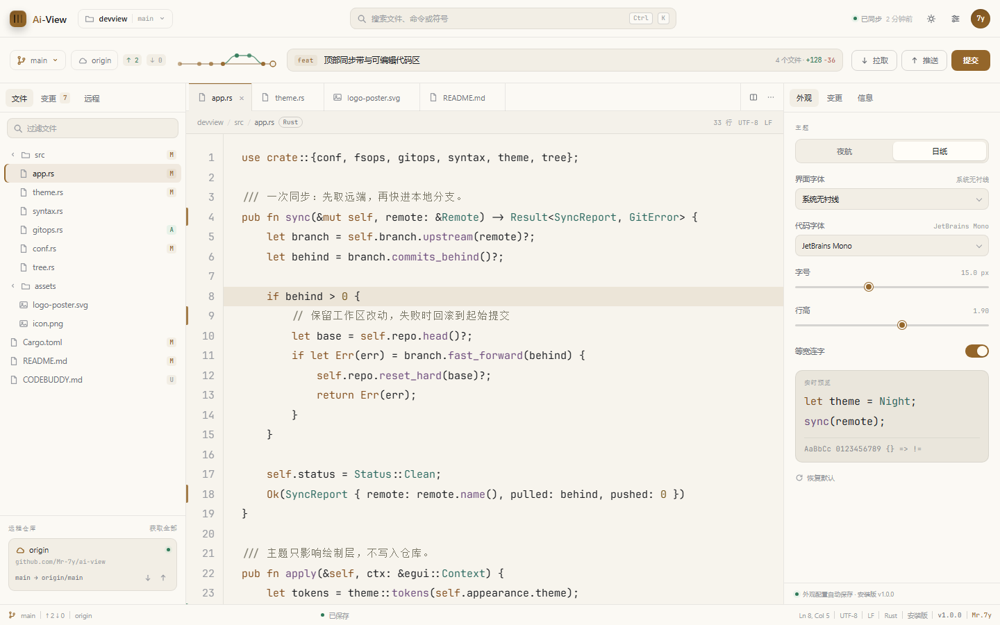
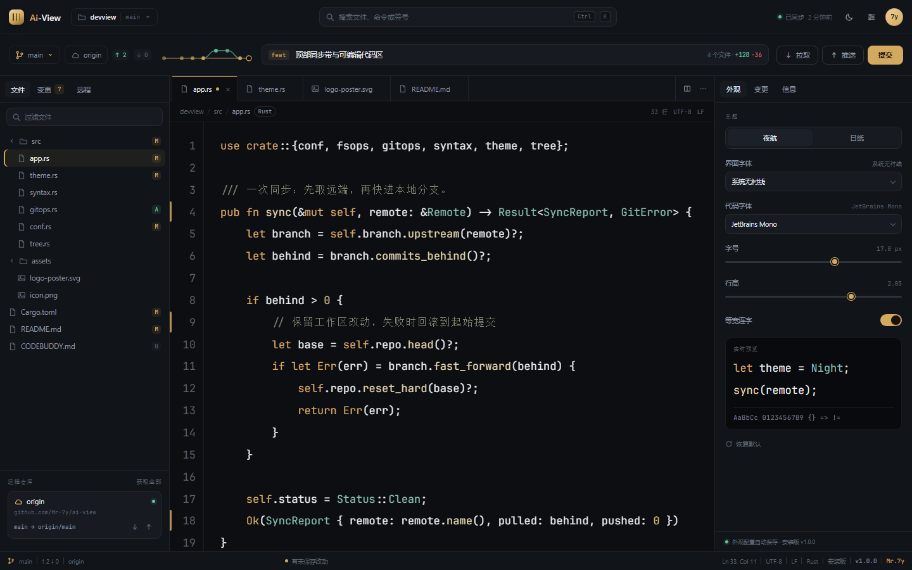
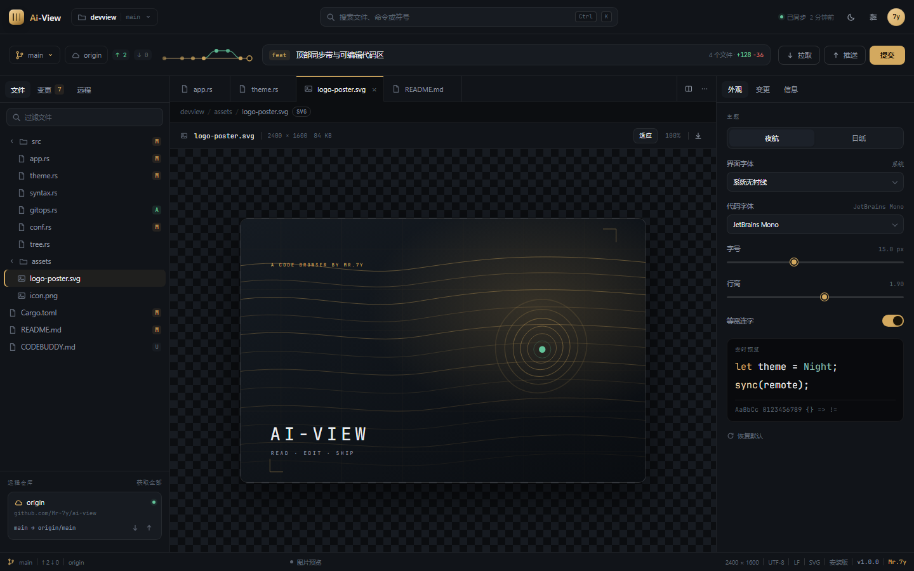
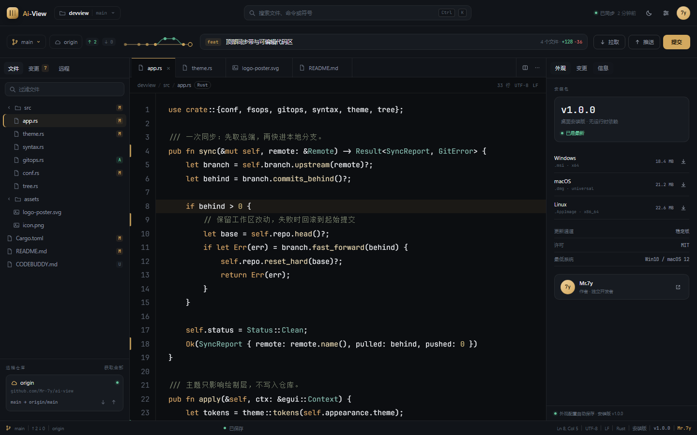
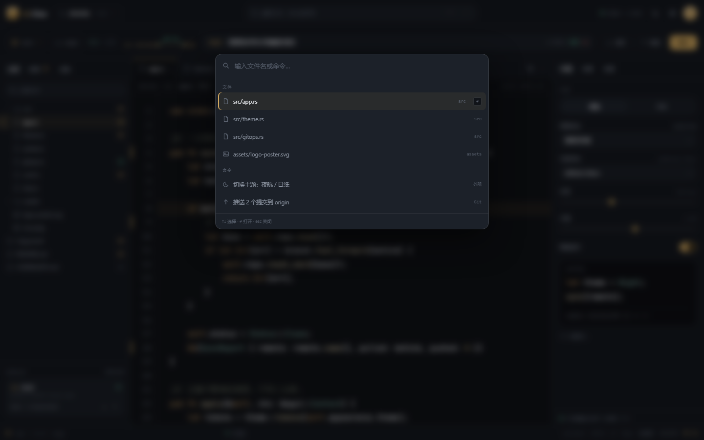

# Ai-View — 设计评估报告

**结论：PASS · 8.55 / 10**（通过线 7.5）
**日期：2026-11-09** · 名称：Ai-View · 作者：Mr.7y

---

## 交付物

| 文件 | 说明 |
|---|---|
| `design/index.html` | 主界面高保真原型，单文件、离线可用，暗/亮双主题 |
| `design/styleguide.html` | 设计规格页：命题、色彩、字体、组件、安装包、栅格与动效 |
| `shots/dark.png` | 夜航主题 1440×900 |
| `shots/light.png` | 日纸主题 1440×900 |
| `shots/image.png` | 图片预览页 |
| `shots/info.png` | 安装包与作者信息面板 |
| `shots/edit-state.png` | 编辑状态：脏标记、未保存提示、17px / 2.05 实时生效 |
| `shots/palette.png` | 命令面板浮层 |
| `shots/spec.png` | 设计规格页长图 |

打开方式：直接用浏览器打开 `design/index.html`，无需服务器与网络。

---

## 用户要求核查

| 要求 | 实现 | 证据 |
|---|---|---|
| 名字 Ai-View，作者 Mr.7y | 品牌字标、窗口标题、状态栏、信息面板、海报 | `dark.png` |
| 可编辑的代码浏览器 | textarea + 高亮层同步，输入产生脏点与「有未保存改动」，⌘/Ctrl+S 提示保存 | `edit-state.png` |
| 可配置字体 | 界面字体、代码字体、字号 12–20px、行高 1.4–2.3、连字开关，全部实时生效 | `edit-state.png` |
| 夜间 + 白天双主题 | 夜航 / 日纸，各自独立的底色、强调色、代码 token 与选中态 | `dark.png` / `light.png` |
| 代码间距大 | 默认 15px / 1.90 行高，左右 26px，可视 23 行 | `dark.png` |
| git 工作流放上面 | 分支、远程、↑2/↓0、提交图、提交信息、提交/拉取/推送 | `dark.png` 顶栏 |
| 远程仓库 | origin / upstream 卡片，远程 tab，ahead/behind 与拉取推送 | `dark.png` 侧栏 |
| 图片 | SVG 海报预览、2400×1600 / 84KB 元信息、适应/100% 缩放 | `image.png` |
| 安装包形式 | v1.0.0、三平台 .msi/.dmg/.AppImage、体积、更新通道、作者卡 | `info.png` |
| 参考主流代码浏览器 | 三栏工作台、标签页、面包屑、命令面板、变更列表 | 全部截图 |

---

## 评分

| 维度 | 权重 | 得分 | 依据 |
|---|---|---|---|
| 设计质量 | 0.35 | 8.6 | 层级清晰，代码是唯一主角；1.90 行高与 26px 内边距形成稳定的阅读节奏；双主题不是简单反色。扣分项：右栏在小屏下信息密度偏高，状态栏 9.5px 字号偏小。 |
| 原创性 | 0.30 | 8.3 | 墨/纸/黄铜的暖中性色、横贯顶部的 git 胶片带、等高线海报，形成了可辨识的记忆点。扣分项：三栏骨架仍属主流范式，差异化更多在表皮与顶栏。 |
| 工艺 | 0.25 | 8.6 | 图标统一 1.4–1.6px 描边；标签、脏点、悬停、开关、滑块状态完整；代码高亮覆盖关键字/字符串/注释/类型/函数；海报与主题同源。扣分项：字体依赖系统回退，跨机器字形会有差异；棋盘格对比略强。 |
| 功能性 | 0.10 | 9.0 | 编辑、脏标记、保存提示、字体/行高联动、主题切换、标签切换、图片缩放、命令面板、提交交互均可用。扣分项：git 为演示数据，保存只在内存。 |

**加权总分：8.6×0.35 + 8.3×0.30 + 8.6×0.25 + 9.0×0.10 = 8.55**

---

## 硬性项

- [x] 两套主题完整，切换后无残留色（截图双份核对）
- [x] 顶部 git 工作流：分支 / 远程 / ↑↓ / 提交框 / 提交 / 拉取 / 推送
- [x] 字体可配置且实时生效（17px、2.05 已验证）
- [x] 代码区可编辑，产生脏点与状态栏提示
- [x] 图片预览存在
- [x] 安装包、版本、作者可见（信息面板 + 状态栏）
- [x] 无外部依赖（`grep` 未发现 CDN、外链样式、远程图片）

---

## 迭代记录

**v1** — 首屏完成，但发现：右栏预览代码被截断；设置图标与主题图标都像太阳/月亮，语义混淆；初始光标偏移到第 17 行；远程卡片贴着状态栏；暗色注释对比偏低。
**v2** — 缩短预览代码；设置图标改为滑杆；光标落在第 8 行；增加远程区底部留白；提高选中态与注释对比。
**v3** — 尝试增加 84 字符「阅读参考线」，实际截断代码且像多余分隔线，**撤回**；修复图片/文档标签的面包屑、状态栏编码与树选中；补充右栏底部「配置自动保存」。
**v4** — 补齐图片页的编码信息（二进制/只读），规格页代码示例去掉换行，色卡字值可读性提升。

被否决的尝试也记录在此：阅读参考线虽符合「阅读优先」的叙事，但在这个宽度下会穿过代码、增加视觉噪音，因此没有保留。

---

## 验证方法

- Chrome Headless，1440×900，`file://` 直接打开；暗色、亮色、图片页、信息页分别截图。
- 交互验证：注入 `input` 事件模拟编辑，确认标签出现脏点、状态栏变为「有未保存改动」；同时把字号改为 17px、行高改为 2.05，确认代码区与预览同步重排。
- `node --check` 校验内联脚本语法。
- 断网可打开：无 `<link>`、`@import`、远程 `src`。
- 未做：真实 git 操作、真实写盘、跨平台字体矩阵、WCAG 全量对比度计算。

---

## 已知取舍

1. **git 是交互演示**：分支、ahead/behind、提交与推送都有 UI 与反馈，但没有后端仓库操作。接入真实 `git status/diff/commit/push` 是下一步。
2. **保存只在内存**：⌘/Ctrl+S 会清除脏标记并提示，但不会写入磁盘。产品化时需要文件系统权限与冲突处理。
3. **安装包为设计呈现**：三平台体积与文件名是合理占位，未实际构建；真正打包需补签名、公证与更新器。
4. **字体依赖系统**：为避免网络与版权问题不内嵌字体；JetBrains Mono 未安装时会回退到 Cascadia / Consolas，宽度会略有变化。

---

## 下一步建议

- 接入真实 git 命令与仓库状态，提交图改为读取真实 log。
- 增加文件写盘、外部修改检测与冲突提示。
- 字体选择改为读取系统字体列表，并补充中文等宽字体回退链。
- 对小号文本（9–10px）做一次对比度复核，必要时提升到 11px。
- 补 1280×800 与 1920×1080 两个断点的截图，验证三栏在低分辨率下的折叠策略。

---

## 截图

